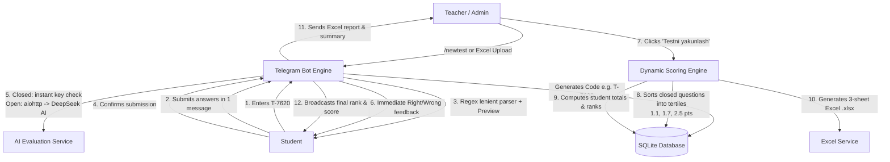
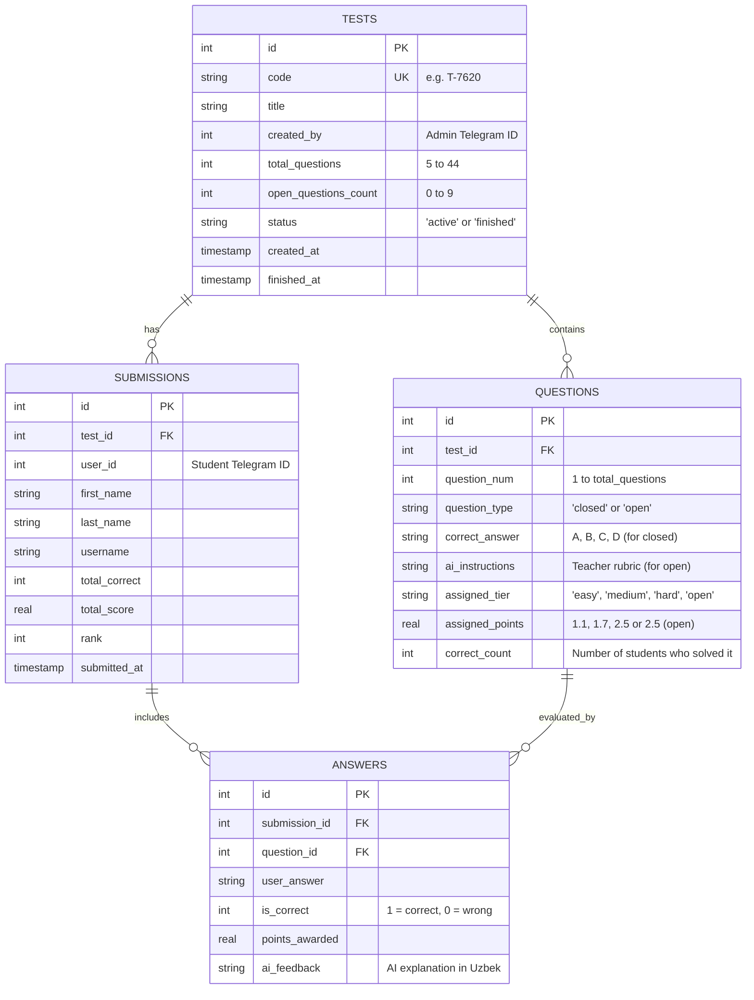

# Ayam Uchun Bot 2: Technical Specification & Codex Developer Guide

> **Target Audience:** Developers and AI Coding Assistants (ChatGPT, OpenAI Codex, Claude, GitHub Copilot) building upon or extending `ayam-uchun-bot-2`.

---

## 1. Project Overview & Business Domain

`ayam-uchun-bot-2` is an educational assessment platform running on Telegram. It is built in Python with **aiogram 3**, **aiosqlite**, and **aiohttp** (for DeepSeek/Gemini LLM calls).

### Core Problem Solved
Traditional Telegram quiz bots only handle closed multiple-choice questions with flat points (e.g. 1 point each). This bot:
1. **Dynamic 3-Tier Difficulty Scoring**: Automatically scales closed question points (1.1, 1.7, 2.5 points) after all students submit, based on the real success rate across the cohort. Easiest questions earn 1.1 pts; hardest questions earn 2.5 pts.
2. **AI-Graded Open Questions**: Allows up to 9 open-ended text questions evaluated in Uzbek by DeepSeek / Gemini AI according to a custom teacher rubric.
3. **Student-Friendly Submissions**: Parses answers flexibly from a single message (e.g. `1:A, 2:B, 3:D, 4: qizil ishton keldi...`).
4. **Two-Stage Reveal**: Students get immediate ✅/❌ feedback upon submission, but exact points and leaderboard rankings remain hidden until the teacher officially finishes the test.

---

## 2. System Architecture & Flow



---

## 3. Database Schema & Architecture (`scripts/database/`)

### Database Engine
- **Engine:** SQLite with WAL mode (`PRAGMA journal_mode = WAL;`) and Foreign Key enforcement (`PRAGMA foreign_keys = ON;`).
- **Connection Timeout:** 60.0s with `PRAGMA busy_timeout = 60000;`.
- **Async Driver:** `aiosqlite`.



### Database Connection Management Rules
> [!IMPORTANT]
> Always use `async with get_db_connection() as db:` from `scripts.database.db` in [`scripts/database/db.py`](scripts/database/db.py).  
> **NEVER** use `async with await aiosqlite.connect(...)` because in `aiosqlite`, calling `__aenter__` on an already-started connection triggers `RuntimeError: threads can only be started once`.  
> Always use `batch_update_...` methods with `executemany` when updating multiple rows.

---

## 4. Dynamic 3-Tier Scoring Algorithm (`services/scoring_service.py`)

### Tertile Distribution Formula
When an admin finishes a test (`finish_test:<test_id>`):
1. Count the number of correct student submissions for each closed question: $C_q$.
2. Sort closed questions in **descending order of $C_q$** (easiest questions with highest accuracy first). Tie-break by `question_num` ascending.
3. Divide the sorted closed questions ($N_{closed}$) into 3 tertiles:
   - `base_size = N_closed // 3`
   - `remainder = N_closed % 3`
   - `easy_count = base_size + (1 if remainder >= 1 else 0)`
   - `medium_count = base_size + (1 if remainder == 2 else 0)`
   - `hard_count = N_closed - easy_count - medium_count`
4. **Point Assignment**:
   - **Top 1/3 (Indices `0` to `easy_count - 1`):** `tier = 'easy'`, **1.1 points**
   - **Middle 1/3 (Indices `easy_count` to `easy_count + medium_count - 1`):** `tier = 'medium'`, **1.7 points**
   - **Bottom 1/3 (Remaining questions):** `tier = 'hard'`, **2.5 points**
5. **Open Questions**:
   - Open questions get fixed points (default `2.5` points, or admin-specified `assigned_points`) if `is_correct == 1`.
6. **Student Total & Ranks**:
   $$\text{total\_score} = \sum_{q \in \text{correct\_answers}} \text{assigned\_points}_q$$
   Submissions are ranked descending by `total_score`, then descending by `total_correct`.

---

## 5. Answer Parser Engine (`utils/parser.py`)

The bot accepts flexible formats from students to minimize typing friction:

### Accepted Student Formats
1. **Multiline Format**:
   ```text
   1. A
   2. B
   3. D
   4. qizil ishton keldi
   5. C
   ```
2. **Delimited Single-Line (User's Favorite)**:
   ```text
   1:A, 2:B, 3:D, 4: qizil ishton keldi, 5: D, 6:A, 7:A, 8: daraxtdan darak tushdi.
   ```
3. **Punctuation Variations**:
   `1) A`, `1 - B`, `1.A`, `1: A`. Open-ended text answers can contain internal commas, dots, and Uzbek letters (`o'`, `g'`, `sh`, `ch`).

### Regex Pattern
```python
pattern = re.compile(
    r"(?:^|[\n,;])\s*(?:savol\s*)?(\d{1,2})\s*[\.:\)\-]\s*(.*?)(?=(?:[\n,;]\s*(?:savol\s*)?\d{1,2}\s*[\.:\)\-]|\Z))",
    re.IGNORECASE | re.DOTALL
)
```

### Admin Test Creation Parser
Admin creates tests via text:
```text
Matematika va Ona tili
1. A
2. B
3. C
4. [OPEN] O'quvchi fe'l so'z turkumiga 2 ta misol keltirishi shart.
5. D
```
- Total questions must be between **5 and 44**.
- Maximum **9 open questions** allowed.
- Must have contiguous numbering from `1` to `N`.

---

## 6. AI Evaluation Service (`services/ai_service.py`)

- **Protocol:** Direct REST call via `aiohttp.ClientSession` to `https://api.deepseek.com/v1/chat/completions` (or Google Gemini API fallback).
- **Why no `openai` SDK?** Avoids heavy binary dependencies (`jiter`, Rust wheels) that fail on older server environments (e.g. Python 3.8). `aiohttp` is already bundled with `aiogram`.
- **System Prompt**: Instructs the LLM in Uzbek to act as an impartial examiner. It accepts minor spelling mistakes if the core meaning matches the teacher's rubric.
- **Output Schema**:
  ```json
  {
    "is_correct": true,
    "explanation": "Qisqa izoh (o'zbek tilida)"
  }
  ```

---

## 7. Telegram FSM States & Routing

### State Machine (`states.py`)
```python
class AdminStates(StatesGroup):
    waiting_for_test_input = State()

class StudentStates(StatesGroup):
    waiting_for_test_code = State()
    waiting_for_answers = State()
    confirming_submission = State()
```

### Handler Responsibilities
| File | Main Responsibilities |
| :--- | :--- |
| [`handlers/common.py`](file:///home/dragonfire/Desktop/Projects/ayam-uchun-bot-2/handlers/common.py) | `/start`, `/help`, main menu reply keyboard, cancel handlers. |
| [`handlers/admin.py`](file:///home/dragonfire/Desktop/Projects/ayam-uchun-bot-2/handlers/admin.py) | `/newtest`, Excel template upload, `/tests` dashboard, `finish_test:<id>`, `download_excel:<id>`. |
| [`handlers/student.py`](file:///home/dragonfire/Desktop/Projects/ayam-uchun-bot-2/handlers/student.py) | `✍️ Test topshirish`, direct `T-XXXX` test code detection, answer intake, preview confirmation, immediate feedback. |

---

## 8. Critical Guidelines for Codex / AI Assistants

When extending or modifying this project, Codex / ChatGPT **must strictly follow these rules**:

1. **Python 3.12+ Regex Rule:**
   - **Never** place inline flags after `^` (e.g. `r"^(?i)abc"`). Python 3.12 raises `re.error: global flags not at the start of the expression`.
   - Use explicit character sets like `r"^([tT]-)?\d{4,6}$"` instead.
2. **Database Connection Pattern:**
   - Always:
     ```python
     async with get_db_connection() as db:
         await db.execute(...)
         await db.commit()
     ```
   - Do **NOT** use `async with await get_db_connection()`!
3. **No Heavy SDKs for AI:**
   - Keep `services/ai_service.py` using `aiohttp`. Do not re-add `import openai` or `pip install openai`.
4. **Preserve One-Submission-Per-Student Lock:**
   - Once a student confirms their answers, `get_submission(test_id, user_id)` must prevent duplicate submissions.
5. **Testing Verification:**
   - Any new feature must pass the pytest test suite:
     ```bash
     .venv/bin/pytest tests/ -v
     ```
   - Current test coverage: 22 automated tests covering parsing, scoring, Excel, AI evaluation, SQLite backups, container configuration, and deployment failure handling.

---

## 9. File Tree & Resource Map

```
/home/dragonfire/Desktop/Projects/ayam-uchun-bot-2/
├── .env.example              # Template for environment variables
├── requirements.txt          # Minimal, pinned dependencies
├── config.py                 # Centralized configuration & environment loader
├── states.py                 # FSM states (AdminStates, StudentStates)
├── main.py                   # Entry point, router inclusion & polling dispatcher
├── scripts/database/
│   ├── db.py                 # SQLite connection manager with WAL mode
│   └── models.py             # CRUD operations (tests, questions, submissions, answers)
├── services/
│   ├── ai_service.py         # Async REST evaluator for open questions (DeepSeek/Gemini)
│   ├── scoring_service.py    # Analytics & 3-tier tertile distribution (1.1, 1.7, 2.5 pts)
│   └── excel_service.py      # openpyxl 3-sheet report generator
├── handlers/
│   ├── common.py             # /start, /help, main navigation
│   ├── admin.py              # Test creation, management, scoring, and report export
│   └── student.py            # Test code intake, answer parser, preview, immediate scoring
├── keyboards/
│   ├── reply.py              # Main menu keyboards
│   └── inline.py             # Submission confirmation & admin control buttons
├── utils/
│   └── parser.py             # Regex parsers for student answers and admin input
└── tests/
    ├── test_parser.py        # Unit tests for text & punctuation parsing
    ├── test_scoring.py       # Unit tests for tertile scoring & DB integration
    ├── test_excel.py         # Verification for .xlsx generation
    └── test_ai_service.py    # Mock tests for AI evaluation
```

## 10. Deployment Decision

Deploy to one Hetzner Linux server with Docker Compose using prebuilt Docker Hub
images selected by digest. GitHub Actions builds and tests releases; production
does not build source. `compose.dev.yaml` is a separate local build definition.
The production runtime is Python 3.14 with constrained dependencies, a non-root
container user, persistent SQLite/report storage, and rotating container logs.

See the deployment section in [README.md](README.md) for registry configuration,
server setup, deployment, backups, rollback, and the remaining production
readiness work. Deployment scaffolding is implemented; reliable interruption
recovery, durable grading/delivery, and versioned migrations remain prerequisites
for production assessments.
